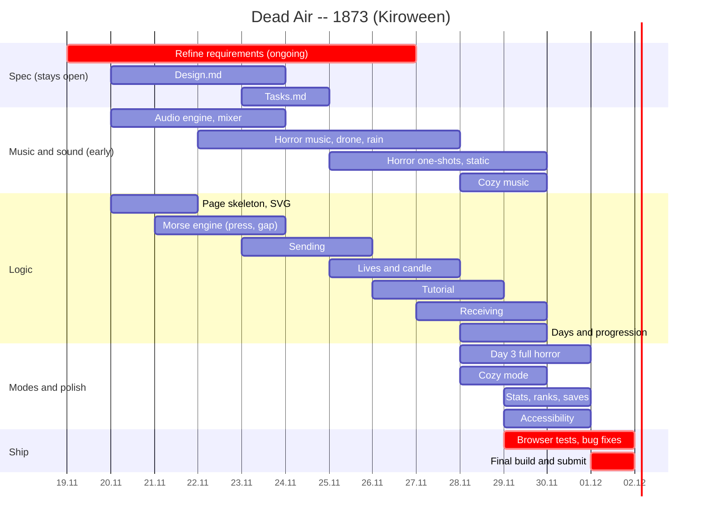

# Dead Air -- 1873: plan with overlaps

Start: 2026-11-19. Submit: 2026-12-01. That is 13 days.
Work overlaps on purpose. Requirements keep changing while music and logic are built.

## Overlaps

| Work A | Overlaps with | Why |
|---|---|---|
| Requirements | Design, audio, Morse engine | Wording changes, code follows |
| Audio engine | Design | Sound needs no final design |
| Horror music | Sending, lives | Music is a separate file |
| Tutorial | Lives, receiving | Reuses the same Morse engine |
| Day 3 horror, Cozy | Days, stats | Same screens, new rules |
| Tests | Polish | Fix bugs as they show up |

## Milestones

| Date  | Goal |
|-------|------|
| 22.11 | Audio engine and Morse engine work |
| 25.11 | Requirements and design settled |
| 26.11 | Sending works |
| 28.11 | Lives, tutorial work |
| 01.12 | Submit |

## Risks

- No spare day. Stop adding features on 30.11.
- Cut first if late: horror one-shot sounds, then Cozy music.
- Test Safari and Firefox audio on 29.11, not later.
